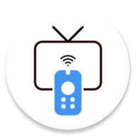

<div align="center">



# 📺 Android TV Remote

### Control your Android TV from your phone — wirelessly, instantly, freely.

[](https://android.com)
[](https://kotlinlang.org)
[](LICENSE)
[](https://github.com/outofcontextapps/androidtvremote)
[-blue?style=for-the-badge)](https://developer.android.com)

<br/>

[](https://play.google.com/store/apps/details?id=com.out.androidtvremote)

<br/>

> **100% Free · No Ads · No Subscriptions · Open Source**

</div>

---

## ✨ What is this?

**Android TV Remote** is a beautiful, fast, and fully-featured remote control app for your Android TV.  
Turn your Android phone into a powerful remote — no Bluetooth pairing, no IR blaster needed. Just Wi-Fi.

Built with love by the **Outofcontext Team** 🇮🇳, and now **completely open source** for the community.

---

## 🎬 Features at a Glance

<table>
  <tr>
    <td align="center">🕹️</td>
    <td><b>Smart D-Pad</b> — Precision navigation with swipe gestures and click zones</td>
  </tr>
  <tr>
    <td align="center">⌨️</td>
    <td><b>Keyboard Input</b> — Type on your TV from your phone keyboard, instantly</td>
  </tr>
  <tr>
    <td align="center">🖱️</td>
    <td><b>Trackpad Mode</b> — Use your phone screen as a mouse touchpad</td>
  </tr>
  <tr>
    <td align="center">🔊</td>
    <td><b>Voice Control</b> — Send voice commands directly to your Android TV</td>
  </tr>
  <tr>
    <td align="center">🚀</td>
    <td><b>Quick Access Apps</b> — Launch your favourite apps in one tap</td>
  </tr>
  <tr>
    <td align="center">🎵</td>
    <td><b>Media Casting</b> — Cast music, videos & photos from your phone to your TV</td>
  </tr>
  <tr>
    <td align="center">🔢</td>
    <td><b>Number Pad</b> — Full numeric keypad for channels and PINs</td>
  </tr>
  <tr>
    <td align="center">💡</td>
    <td><b>Device Discovery</b> — Auto-detects Android TVs on your local Wi-Fi network</td>
  </tr>
  <tr>
    <td align="center">🎨</td>
    <td><b>Themes</b> — Light, dark, and system-follow theme support</td>
  </tr>
  <tr>
    <td align="center">⚡</td>
    <td><b>Instant Launch</b> — Zero splash delay, app is ready the moment you open it</td>
  </tr>
</table>

---

## 📸 Screenshots

<div align="center">
  
  &nbsp;
  
  &nbsp;
  
  &nbsp;
  
</div>

---

## 🛠️ Tech Stack

| Layer | Technology |
|---|---|
| Language | **Kotlin** |
| UI | **Material Design 3** · View Binding · Navigation Component |
| Connectivity | **Android TV Remote Protocol** (TLS/mDNS) · ConnectSDK |
| Networking | OkHttp · Retrofit · Ktor · NanoHTTPD |
| Async | Kotlin Coroutines · Flow · LiveData |
| DI Pattern | Manual singleton repositories |
| Media Casting | ConnectSDK · ExoPlayer |
| Crash Reporting | Firebase Crashlytics |
| Minimum SDK | Android 7.0 (API 24) |
| Target SDK | Android 15 (API 35) |

---

## 🚀 Getting Started

### Prerequisites
- Android Studio **Hedgehog** or newer
- JDK **17+**
- An Android TV device or emulator on the same Wi-Fi network

### Build & Run

```bash
# 1. Clone the repository
git clone https://github.com/outofcontextapps/androidtvremote.git
cd androidtvremote

# 2. Add your Firebase config (required for Crashlytics)
#    Download google-services.json from your Firebase console
#    and place it at: app/google-services.json

# 3. Open in Android Studio and run!
```

> **Note:** `google-services.json` and signing keystores are excluded from this repository for security. You will need to create your own Firebase project or disable the Firebase plugins in `build.gradle.kts` if you just want to build locally.

---

## 📂 Project Structure

```
androidtvremote/
├── app/
│   ├── src/main/
│   │   ├── java/com/out/androidtvremote/
│   │   │   ├── androidLib/        # Android TV pairing & remote protocol
│   │   │   ├── services/          # KeepAlive & Cast foreground services
│   │   │   ├── ui/
│   │   │   │   ├── activities/    # MainActivity, SplashActivity, SearchActivity…
│   │   │   │   └── frags/         # Remote, Cast, Apps, Settings fragments
│   │   │   ├── utils/             # Helpers, constants, QuickAccess
│   │   │   └── views/             # Custom DpadView
│   │   └── res/                   # Layouts, drawables, strings, themes
│   └── build.gradle.kts
├── ConnectSDK/                    # Google Cast discovery library (submodule)
├── gradle/
└── README.md
```

---

## 🤝 Contributing

We welcome contributions from everyone! Here's how to get started:

1. **Fork** this repository
2. **Create** your feature branch: `git checkout -b feature/amazing-feature`
3. **Commit** your changes: `git commit -m 'Add amazing feature'`
4. **Push** to the branch: `git push origin feature/amazing-feature`
5. **Open a Pull Request** — we review and merge quickly!

### Ideas for contribution
- 🌍 Translations / localization
- 🎨 UI themes & custom layouts
- 🐛 Bug fixes & stability improvements
- ✨ New remote control features
- 📖 Documentation improvements

---

## 🐛 Found a Bug?

[Open an issue](https://github.com/outofcontextapps/androidtvremote/issues/new) with:
- Your Android version
- TV model / Android TV version
- Steps to reproduce
- Screenshots (if possible)

---

## 📜 License

```
MIT License

Copyright (c) 2024 Outofcontext Team

Permission is hereby granted, free of charge, to any person obtaining a copy
of this software and associated documentation files (the "Software"), to deal
in the Software without restriction, including without limitation the rights
to use, copy, modify, merge, publish, distribute, sublicense, and/or sell
copies of the Software, and to permit persons to whom the Software is
furnished to do so, subject to the following conditions:

The above copyright notice and this permission notice shall be included in all
copies or substantial portions of the Software.

THE SOFTWARE IS PROVIDED "AS IS", WITHOUT WARRANTY OF ANY KIND, EXPRESS OR
IMPLIED, INCLUDING BUT NOT LIMITED TO THE WARRANTIES OF MERCHANTABILITY,
FITNESS FOR A PARTICULAR PURPOSE AND NONINFRINGEMENT.
```

---

## 💬 Community & Support

<div align="center">

[⭐ Star this repo](https://github.com/outofcontextapps/androidtvremote) · [🐛 Report Bug](https://github.com/outofcontextapps/androidtvremote/issues) · [💡 Request Feature](https://github.com/outofcontextapps/androidtvremote/issues)

<br/>

[](https://play.google.com/store/apps/details?id=com.out.androidtvremote)

<br/>

**Made with ❤️ in India by the Outofcontext Team**

</div>
